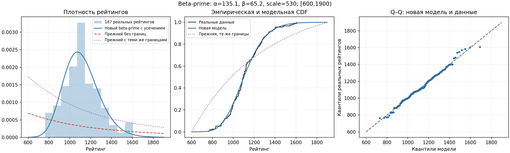

# Калибровка beta-prime по реальным рейтингам

Источник: [real-ratings.txt](data/real-ratings.txt), **187 наблюдений**.
Все записи, включая последние пять повторяющихся значений, учтены по указанию пользователя.
Копия сохраняет порядок и значения исходного файла «Для распределения.txt»; окончания строк приведены к LF.
SHA256 копии: `19f7f464155090f8208c3d81d07a773ff8f650d899cfbb3a13d716e67673b84c`.

Прежняя генерация отношения двух гамма-величин математически соответствует beta-prime.
Проблема была в неподходящих коэффициентах и неограниченной области рейтингов.
При α=2, β=3, scale=1000 среднее равно 1000, стандартное отклонение ≈1414;
в данных среднее 1115.578, стандартное отклонение 170.067.

## Метод подбора

R = scale · G₁/G₂, G₁~Gamma(α,1), G₂~Gamma(β,1), location=0.
Рабочий диапазон **[600,1900)** выбран пользователем; это границы эксперимента,
а не оценка универсальной шкалы рейтингов. Значения вне диапазона отбрасываются и выбираются заново.
Рейтинги не обрезаются к границе и не растягиваются. Наблюдаемые минимум и максимум
равны 763 и 1607; они не подставлены в качестве ограничений генерации.

Минимизируется отрицательное логарифмическое правдоподобие **усечённого** распределения:

```text
NLL = −Σ log f(Rᵢ; α,β,scale) + n·log[F(U)−F(L)]
f(R) = (R/scale)^(α−1) · (1+R/scale)^(−α−β) / [scale·B(α,β)]
```

Положительность параметров обеспечена оптимизацией их логарифмов. Проверены три
детерминированные начальные точки методом Nelder–Mead; сохранены статусы сходимости.
Коэффициенты округлены до 0.1 для устойчивого воспроизведения; исходная оценка сохранена в JSON.

| Параметр | MLE | Применённое значение |
|---|---:|---:|
| alpha | 135.074387 | 135.1 |
| beta | 65.158106 | 65.2 |
| scale | 529.977660 | 530 |

Потеря NLL при округлении: 0.000706.
Вероятность принятия кандидата: 0.99973478.

## Соответствие данным

| Квантиль | Реальные рейтинги | Новая модель | Прежняя с теми же границами |
|---|---:|---:|---:|
| 5% | 847.300 | 861.709 | 629.555 |
| 25% | 997.000 | 995.024 | 762.876 |
| 50% | 1094.000 | 1101.073 | 979.788 |
| 75% | 1220.500 | 1219.872 | 1302.730 |
| 95% | 1399.800 | 1416.730 | 1738.316 |

Расстояние эмпирической CDF до новой модели: 0.060758;
до прежней с теми же границами: 0.345089.
Это описательная оценка на данных подбора, не независимая проверка и не p-value.
Связи между записями и происхождение групп в исходном файле не известны;
калибровка описывает именно предоставленную выборку.



## Воспроизведение и диапазоны

```bash
.venv/bin/python -m pip install -r requirements-dev.txt
.venv/bin/python scripts/fit_rating_distribution.py --rating-min 600 --rating-max 1900
.venv/bin/python -m simulation --elo --elo-tire --grin-cycle --grin-elo \
  --distribution beta-prime --alpha 135.1 --beta 65.2 --scale 530 --rating-min 600 --rating-max 1900
# Историческая неограниченная модель:
.venv/bin/python -m simulation --elo --grin-cycle --alpha 2 --beta 3 --scale 1000 --unbounded-beta-prime
```

SciPy 1.15.3, NumPy 2.2.6. Подбор выполняется отдельно от моделирования турниров.
[JSON с параметрами и диагностикой](beta-prime-fit.json).
[Формула beta-prime](https://docs.scipy.org/doc/scipy-1.15.3/reference/generated/scipy.stats.betaprime.html),
[методы оптимизации](https://docs.scipy.org/doc/scipy-1.15.3/reference/generated/scipy.optimize.minimize.html).
