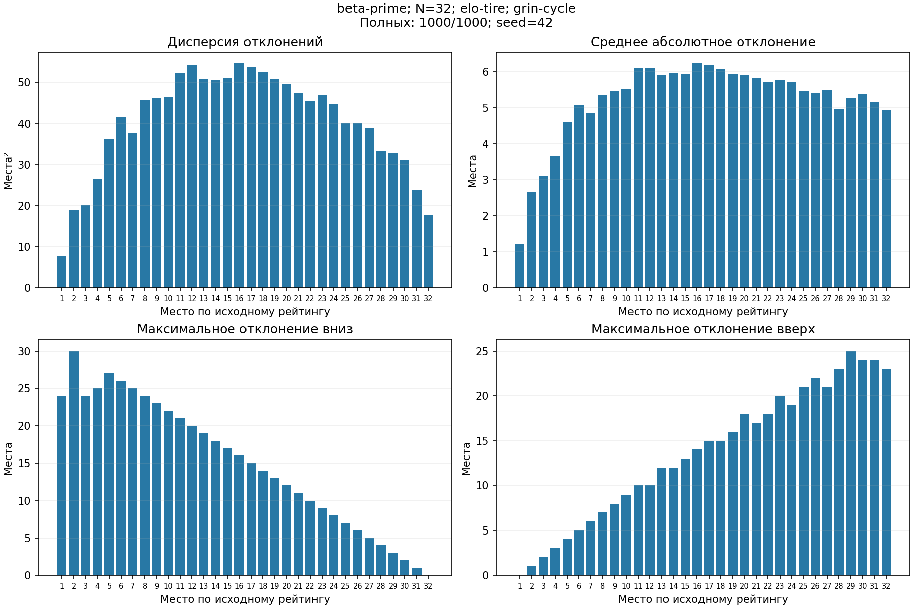
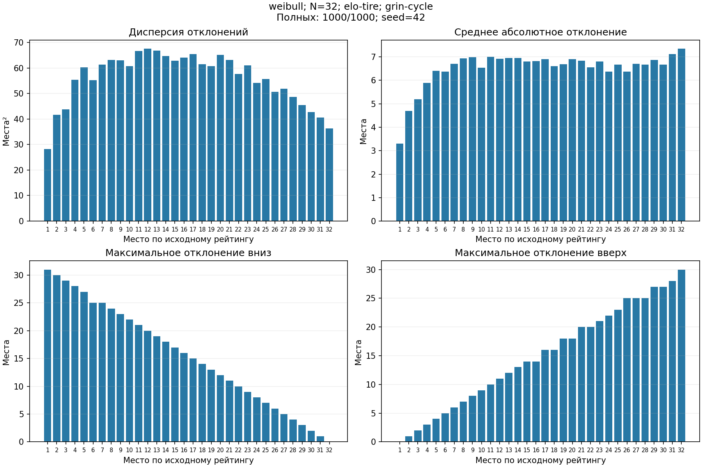
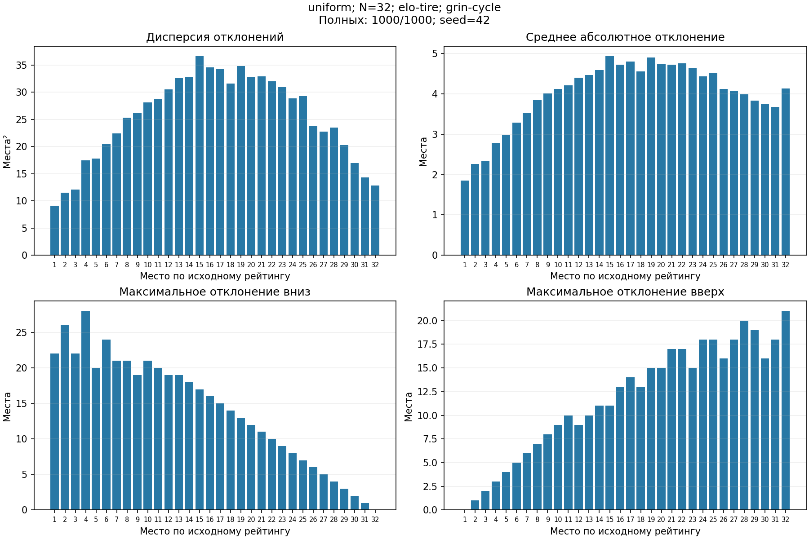

# Эксперимент elo-tire: точность мест

Всего **36000 турниров**; N=8, 16, 32; по 1000 повторов на сочетание; seed=42.

Случайная жеребьёвка, сетка DE_OLD_fix. Веса циклов: 0.33, 0.33, 0.33, нормированы до 1.
`grin-cycle` — основной метод без исходных рейтингов. `grin-elo` использует рейтинги соперников при отказе графа.
Призёры в обоих методах фиксируются по решающим боям.

Распределения: beta-prime (α=135.1, β=65.2, scale=530), [600,1900);
Weibull (2.2, scale=220, location=852) без усечения;
uniform [600,1900).
elo-tire: A=0.85, A′=0.90, C=400, N_f=3; dR=200; K=160.
Границы — параметры эксперимента, не универсальные границы рейтингов.
Сравнение распределений включает различия их формы и масштаба.

Beta-prime откалиброван по **187 реальным рейтингам**, все записи учтены.
[Данные и метод подбора](beta-prime-calibration.md); [параметры и диагностика](beta-prime-fit.json).
Вне границ кандидаты отбрасываются и выбираются заново. Усталость, dR и сетка не изменены.

Полные расстановки: grin-cycle **36000/36000**, grin-elo **36000/36000**.
Этап циклов запущен 2184 раз, завершён 2184 раз; рейтинговый резерв — 2184 раз.
Полнота на этой серии не является доказательством разрешимости произвольного входа.

## beta-prime

| N | Модель | Полных cycle / elo | Циклов | Резерв Эло | MAE cycle | MAE elo | Spearman cycle | Spearman elo | Сильнейший победил |
|---:|---|---:|---:|---:|---:|---:|---:|---:|---:|
| 8 | strong-win | 1000 / 1000 | 0 | 0 | 0.377250 | 0.377250 | 0.954357 | 0.954357 | 1.000000 |
| 8 | elo | 1000 / 1000 | 0 | 0 | 1.119000 | 1.119000 | 0.753738 | 0.753738 | 0.725000 |
| 8 | elo-stamina | 1000 / 1000 | 0 | 0 | 1.169250 | 1.169250 | 0.739190 | 0.739190 | 0.682000 |
| 8 | elo-tire | 1000 / 1000 | 0 | 0 | 1.147500 | 1.147500 | 0.745476 | 0.745476 | 0.712000 |
| 16 | strong-win | 1000 / 1000 | 0 | 0 | 1.285125 | 1.285125 | 0.916629 | 0.916629 | 1.000000 |
| 16 | elo | 1000 / 1000 | 67 | 67 | 2.464000 | 2.503750 | 0.738100 | 0.729585 | 0.690000 |
| 16 | elo-stamina | 1000 / 1000 | 86 | 86 | 2.563500 | 2.612750 | 0.721809 | 0.711303 | 0.601000 |
| 16 | elo-tire | 1000 / 1000 | 68 | 68 | 2.534625 | 2.571750 | 0.726050 | 0.717624 | 0.636000 |
| 32 | strong-win | 1000 / 1000 | 0 | 0 | 3.029500 | 3.029500 | 0.896405 | 0.896405 | 1.000000 |
| 32 | elo | 1000 / 1000 | 170 | 170 | 5.075000 | 5.223375 | 0.731460 | 0.715210 | 0.684000 |
| 32 | elo-stamina | 1000 / 1000 | 186 | 186 | 5.223687 | 5.399687 | 0.719152 | 0.699036 | 0.583000 |
| 32 | elo-tire | 1000 / 1000 | 174 | 174 | 5.225875 | 5.400313 | 0.718611 | 0.699310 | 0.647000 |

### elo-tire, N=32, grin-cycle: отклонения по местам

Учтено 1000 полных расстановок; пропущено 0.

| Место | Дисперсия δ | Среднее \|δ\| | Максимум вниз | Максимум вверх |
|---:|---:|---:|---:|---:|
| 1 | 7.757271 | 1.223000 | 24.000000 | 0.000000 |
| 2 | 19.013375 | 2.675000 | 30.000000 | 1.000000 |
| 3 | 20.050636 | 3.096000 | 24.000000 | 2.000000 |
| 4 | 26.463775 | 3.673000 | 25.000000 | 3.000000 |
| 5 | 36.230144 | 4.604000 | 27.000000 | 4.000000 |
| 6 | 41.644519 | 5.093000 | 26.000000 | 5.000000 |
| 7 | 37.615536 | 4.846000 | 25.000000 | 6.000000 |
| 8 | 45.773591 | 5.371000 | 24.000000 | 7.000000 |
| 9 | 46.088064 | 5.476000 | 23.000000 | 8.000000 |
| 10 | 46.398911 | 5.525000 | 22.000000 | 9.000000 |
| 11 | 52.233184 | 6.096000 | 21.000000 | 10.000000 |
| 12 | 54.074816 | 6.102000 | 20.000000 | 10.000000 |
| 13 | 50.784375 | 5.923000 | 19.000000 | 12.000000 |
| 14 | 50.599616 | 5.962000 | 18.000000 | 12.000000 |
| 15 | 51.121600 | 5.946000 | 17.000000 | 13.000000 |
| 16 | 54.570391 | 6.239000 | 16.000000 | 14.000000 |
| 17 | 53.671600 | 6.192000 | 15.000000 | 15.000000 |
| 18 | 52.414864 | 6.090000 | 14.000000 | 15.000000 |
| 19 | 50.741916 | 5.930000 | 13.000000 | 16.000000 |
| 20 | 49.514124 | 5.926000 | 12.000000 | 18.000000 |
| 21 | 47.362000 | 5.828000 | 11.000000 | 17.000000 |
| 22 | 45.472751 | 5.719000 | 10.000000 | 18.000000 |
| 23 | 46.859824 | 5.790000 | 9.000000 | 20.000000 |
| 24 | 44.670999 | 5.739000 | 8.000000 | 19.000000 |
| 25 | 40.246400 | 5.480000 | 7.000000 | 21.000000 |
| 26 | 40.090975 | 5.407000 | 6.000000 | 22.000000 |
| 27 | 38.881296 | 5.508000 | 5.000000 | 21.000000 |
| 28 | 33.139500 | 4.980000 | 4.000000 | 23.000000 |
| 29 | 32.940319 | 5.283000 | 3.000000 | 25.000000 |
| 30 | 31.082231 | 5.389000 | 2.000000 | 24.000000 |
| 31 | 23.774639 | 5.179000 | 1.000000 | 24.000000 |
| 32 | 17.680156 | 4.938000 | 0.000000 | 23.000000 |

### elo-tire, N=32, grin-elo: отклонения по местам

Учтено 1000 полных расстановок; пропущено 0.

| Место | Дисперсия δ | Среднее \|δ\| | Максимум вниз | Максимум вверх |
|---:|---:|---:|---:|---:|
| 1 | 9.514791 | 1.297000 | 29.000000 | 0.000000 |
| 2 | 23.222544 | 2.966000 | 27.000000 | 1.000000 |
| 3 | 24.118991 | 3.401000 | 28.000000 | 2.000000 |
| 4 | 30.905375 | 3.983000 | 27.000000 | 3.000000 |
| 5 | 39.201799 | 4.915000 | 27.000000 | 4.000000 |
| 6 | 44.507591 | 5.391000 | 26.000000 | 5.000000 |
| 7 | 40.557616 | 5.088000 | 25.000000 | 6.000000 |
| 8 | 45.240471 | 5.495000 | 24.000000 | 7.000000 |
| 9 | 48.567500 | 5.714000 | 23.000000 | 8.000000 |
| 10 | 49.772119 | 5.739000 | 22.000000 | 9.000000 |
| 11 | 54.453536 | 6.302000 | 21.000000 | 10.000000 |
| 12 | 54.563871 | 6.193000 | 20.000000 | 10.000000 |
| 13 | 53.001616 | 6.114000 | 19.000000 | 12.000000 |
| 14 | 52.899664 | 6.100000 | 18.000000 | 12.000000 |
| 15 | 51.921600 | 5.978000 | 17.000000 | 13.000000 |
| 16 | 54.346439 | 6.179000 | 16.000000 | 14.000000 |
| 17 | 54.292831 | 6.229000 | 15.000000 | 15.000000 |
| 18 | 54.590604 | 6.264000 | 14.000000 | 15.000000 |
| 19 | 52.235551 | 6.001000 | 13.000000 | 16.000000 |
| 20 | 51.776071 | 6.057000 | 12.000000 | 18.000000 |
| 21 | 49.745584 | 6.030000 | 11.000000 | 17.000000 |
| 22 | 46.861600 | 5.792000 | 10.000000 | 18.000000 |
| 23 | 48.750471 | 5.955000 | 9.000000 | 20.000000 |
| 24 | 46.730975 | 5.883000 | 8.000000 | 20.000000 |
| 25 | 41.510956 | 5.524000 | 7.000000 | 21.000000 |
| 26 | 42.461279 | 5.549000 | 6.000000 | 22.000000 |
| 27 | 40.527056 | 5.682000 | 5.000000 | 22.000000 |
| 28 | 37.278511 | 5.367000 | 4.000000 | 24.000000 |
| 29 | 36.629999 | 5.515000 | 3.000000 | 25.000000 |
| 30 | 34.699775 | 5.653000 | 2.000000 | 26.000000 |
| 31 | 26.799184 | 5.320000 | 1.000000 | 27.000000 |
| 32 | 20.910044 | 5.134000 | 0.000000 | 24.000000 |



## weibull

| N | Модель | Полных cycle / elo | Циклов | Резерв Эло | MAE cycle | MAE elo | Spearman cycle | Spearman elo | Сильнейший победил |
|---:|---|---:|---:|---:|---:|---:|---:|---:|---:|
| 8 | strong-win | 1000 / 1000 | 0 | 0 | 0.367750 | 0.367750 | 0.956571 | 0.956571 | 1.000000 |
| 8 | elo | 1000 / 1000 | 0 | 0 | 1.480250 | 1.480250 | 0.613690 | 0.613690 | 0.589000 |
| 8 | elo-stamina | 1000 / 1000 | 0 | 0 | 1.546500 | 1.546500 | 0.589714 | 0.589714 | 0.496000 |
| 8 | elo-tire | 1000 / 1000 | 0 | 0 | 1.525750 | 1.525750 | 0.597095 | 0.597095 | 0.551000 |
| 16 | strong-win | 1000 / 1000 | 0 | 0 | 1.283875 | 1.283875 | 0.916800 | 0.916800 | 1.000000 |
| 16 | elo | 1000 / 1000 | 89 | 89 | 3.139875 | 3.187125 | 0.600526 | 0.590006 | 0.506000 |
| 16 | elo-stamina | 1000 / 1000 | 121 | 121 | 3.228750 | 3.295375 | 0.582018 | 0.566803 | 0.443000 |
| 16 | elo-tire | 1000 / 1000 | 101 | 101 | 3.203000 | 3.264250 | 0.586394 | 0.572585 | 0.469000 |
| 32 | strong-win | 1000 / 1000 | 0 | 0 | 2.993187 | 2.993187 | 0.897826 | 0.897826 | 1.000000 |
| 32 | elo | 1000 / 1000 | 222 | 222 | 6.382313 | 6.622438 | 0.593562 | 0.564553 | 0.475000 |
| 32 | elo-stamina | 1000 / 1000 | 237 | 237 | 6.544688 | 6.825375 | 0.576403 | 0.542066 | 0.374000 |
| 32 | elo-tire | 1000 / 1000 | 230 | 230 | 6.518000 | 6.787375 | 0.578761 | 0.546444 | 0.435000 |

### elo-tire, N=32, grin-cycle: отклонения по местам

Учтено 1000 полных расстановок; пропущено 0.

| Место | Дисперсия δ | Среднее \|δ\| | Максимум вниз | Максимум вверх |
|---:|---:|---:|---:|---:|
| 1 | 28.262364 | 3.306000 | 31.000000 | 0.000000 |
| 2 | 41.616284 | 4.700000 | 30.000000 | 1.000000 |
| 3 | 43.722336 | 5.198000 | 29.000000 | 2.000000 |
| 4 | 55.401344 | 5.896000 | 28.000000 | 3.000000 |
| 5 | 60.323936 | 6.400000 | 27.000000 | 4.000000 |
| 6 | 55.153884 | 6.370000 | 25.000000 | 5.000000 |
| 7 | 61.245839 | 6.707000 | 25.000000 | 6.000000 |
| 8 | 63.199375 | 6.933000 | 24.000000 | 7.000000 |
| 9 | 63.011439 | 6.991000 | 23.000000 | 8.000000 |
| 10 | 60.704636 | 6.546000 | 22.000000 | 9.000000 |
| 11 | 66.581100 | 7.006000 | 21.000000 | 10.000000 |
| 12 | 67.520796 | 6.916000 | 20.000000 | 11.000000 |
| 13 | 66.742400 | 6.950000 | 19.000000 | 12.000000 |
| 14 | 64.696496 | 6.948000 | 18.000000 | 13.000000 |
| 15 | 62.783100 | 6.804000 | 17.000000 | 14.000000 |
| 16 | 64.019916 | 6.820000 | 16.000000 | 14.000000 |
| 17 | 65.472975 | 6.911000 | 15.000000 | 16.000000 |
| 18 | 61.452924 | 6.606000 | 14.000000 | 16.000000 |
| 19 | 60.684816 | 6.694000 | 13.000000 | 18.000000 |
| 20 | 65.107904 | 6.900000 | 12.000000 | 18.000000 |
| 21 | 63.142624 | 6.840000 | 11.000000 | 20.000000 |
| 22 | 57.689071 | 6.563000 | 10.000000 | 20.000000 |
| 23 | 61.079484 | 6.796000 | 9.000000 | 21.000000 |
| 24 | 54.118784 | 6.370000 | 8.000000 | 22.000000 |
| 25 | 55.708439 | 6.663000 | 7.000000 | 23.000000 |
| 26 | 50.639671 | 6.365000 | 6.000000 | 25.000000 |
| 27 | 51.911631 | 6.697000 | 5.000000 | 25.000000 |
| 28 | 48.594975 | 6.679000 | 4.000000 | 25.000000 |
| 29 | 45.435775 | 6.863000 | 3.000000 | 27.000000 |
| 30 | 42.762375 | 6.677000 | 2.000000 | 27.000000 |
| 31 | 40.553775 | 7.115000 | 1.000000 | 28.000000 |
| 32 | 36.356284 | 7.346000 | 0.000000 | 30.000000 |

### elo-tire, N=32, grin-elo: отклонения по местам

Учтено 1000 полных расстановок; пропущено 0.

| Место | Дисперсия δ | Среднее \|δ\| | Максимум вниз | Максимум вверх |
|---:|---:|---:|---:|---:|
| 1 | 33.076064 | 3.544000 | 31.000000 | 0.000000 |
| 2 | 43.579276 | 4.936000 | 30.000000 | 1.000000 |
| 3 | 48.936975 | 5.561000 | 29.000000 | 2.000000 |
| 4 | 57.951276 | 6.194000 | 28.000000 | 3.000000 |
| 5 | 61.167079 | 6.489000 | 27.000000 | 4.000000 |
| 6 | 60.976816 | 6.768000 | 26.000000 | 5.000000 |
| 7 | 65.626604 | 7.148000 | 25.000000 | 6.000000 |
| 8 | 65.217596 | 7.294000 | 24.000000 | 7.000000 |
| 9 | 68.856975 | 7.323000 | 23.000000 | 8.000000 |
| 10 | 63.484000 | 6.834000 | 22.000000 | 9.000000 |
| 11 | 67.648079 | 7.221000 | 21.000000 | 10.000000 |
| 12 | 71.090844 | 7.226000 | 20.000000 | 11.000000 |
| 13 | 68.533839 | 7.127000 | 19.000000 | 12.000000 |
| 14 | 65.032975 | 6.983000 | 18.000000 | 13.000000 |
| 15 | 66.126284 | 7.046000 | 17.000000 | 14.000000 |
| 16 | 64.966764 | 6.890000 | 16.000000 | 14.000000 |
| 17 | 67.662375 | 7.063000 | 15.000000 | 16.000000 |
| 18 | 62.338759 | 6.691000 | 14.000000 | 16.000000 |
| 19 | 63.790391 | 6.879000 | 13.000000 | 18.000000 |
| 20 | 67.272839 | 7.077000 | 12.000000 | 18.000000 |
| 21 | 64.403264 | 6.914000 | 11.000000 | 20.000000 |
| 22 | 59.690956 | 6.688000 | 10.000000 | 20.000000 |
| 23 | 62.333696 | 6.924000 | 9.000000 | 21.000000 |
| 24 | 55.990556 | 6.618000 | 8.000000 | 22.000000 |
| 25 | 57.635279 | 6.793000 | 7.000000 | 23.000000 |
| 26 | 54.250775 | 6.789000 | 6.000000 | 25.000000 |
| 27 | 55.625775 | 7.111000 | 5.000000 | 25.000000 |
| 28 | 50.962439 | 6.997000 | 4.000000 | 25.000000 |
| 29 | 49.795559 | 7.243000 | 3.000000 | 27.000000 |
| 30 | 48.675975 | 7.119000 | 2.000000 | 27.000000 |
| 31 | 44.218400 | 7.606000 | 1.000000 | 28.000000 |
| 32 | 42.080000 | 8.100000 | 0.000000 | 30.000000 |



## uniform

| N | Модель | Полных cycle / elo | Циклов | Резерв Эло | MAE cycle | MAE elo | Spearman cycle | Spearman elo | Сильнейший победил |
|---:|---|---:|---:|---:|---:|---:|---:|---:|---:|
| 8 | strong-win | 1000 / 1000 | 0 | 0 | 0.390500 | 0.390500 | 0.953143 | 0.953143 | 1.000000 |
| 8 | elo | 1000 / 1000 | 0 | 0 | 0.750750 | 0.750750 | 0.876548 | 0.876548 | 0.805000 |
| 8 | elo-stamina | 1000 / 1000 | 0 | 0 | 0.786250 | 0.786250 | 0.868929 | 0.868929 | 0.759000 |
| 8 | elo-tire | 1000 / 1000 | 0 | 0 | 0.794500 | 0.794500 | 0.866238 | 0.866238 | 0.763000 |
| 16 | strong-win | 1000 / 1000 | 0 | 0 | 1.288250 | 1.288250 | 0.916421 | 0.916421 | 1.000000 |
| 16 | elo | 1000 / 1000 | 30 | 30 | 1.789875 | 1.798625 | 0.858509 | 0.856874 | 0.663000 |
| 16 | elo-stamina | 1000 / 1000 | 52 | 52 | 1.865375 | 1.879375 | 0.850162 | 0.847385 | 0.588000 |
| 16 | elo-tire | 1000 / 1000 | 37 | 37 | 1.881250 | 1.889375 | 0.847062 | 0.845012 | 0.609000 |
| 32 | strong-win | 1000 / 1000 | 0 | 0 | 3.005063 | 3.005063 | 0.897017 | 0.897017 | 1.000000 |
| 32 | elo | 1000 / 1000 | 103 | 103 | 3.863187 | 3.898750 | 0.845731 | 0.841817 | 0.502000 |
| 32 | elo-stamina | 1000 / 1000 | 111 | 111 | 3.951875 | 3.991687 | 0.840789 | 0.836424 | 0.421000 |
| 32 | elo-tire | 1000 / 1000 | 100 | 100 | 3.999312 | 4.033938 | 0.836404 | 0.832763 | 0.455000 |

### elo-tire, N=32, grin-cycle: отклонения по местам

Учтено 1000 полных расстановок; пропущено 0.

| Место | Дисперсия δ | Среднее \|δ\| | Максимум вниз | Максимум вверх |
|---:|---:|---:|---:|---:|
| 1 | 9.136199 | 1.849000 | 22.000000 | 0.000000 |
| 2 | 11.534775 | 2.263000 | 26.000000 | 1.000000 |
| 3 | 12.089024 | 2.334000 | 22.000000 | 2.000000 |
| 4 | 17.414151 | 2.787000 | 28.000000 | 3.000000 |
| 5 | 17.806400 | 2.974000 | 20.000000 | 4.000000 |
| 6 | 20.491900 | 3.284000 | 24.000000 | 5.000000 |
| 7 | 22.384176 | 3.532000 | 21.000000 | 6.000000 |
| 8 | 25.317375 | 3.841000 | 21.000000 | 7.000000 |
| 9 | 26.122256 | 4.012000 | 19.000000 | 8.000000 |
| 10 | 28.115191 | 4.119000 | 21.000000 | 9.000000 |
| 11 | 28.778471 | 4.213000 | 20.000000 | 10.000000 |
| 12 | 30.530000 | 4.402000 | 19.000000 | 9.000000 |
| 13 | 32.574711 | 4.467000 | 19.000000 | 10.000000 |
| 14 | 32.767079 | 4.591000 | 18.000000 | 11.000000 |
| 15 | 36.597900 | 4.932000 | 17.000000 | 11.000000 |
| 16 | 34.547184 | 4.728000 | 16.000000 | 13.000000 |
| 17 | 34.250416 | 4.802000 | 15.000000 | 14.000000 |
| 18 | 31.617900 | 4.562000 | 14.000000 | 13.000000 |
| 19 | 34.845584 | 4.906000 | 13.000000 | 15.000000 |
| 20 | 32.836199 | 4.733000 | 12.000000 | 15.000000 |
| 21 | 32.922831 | 4.725000 | 11.000000 | 17.000000 |
| 22 | 32.013759 | 4.753000 | 10.000000 | 17.000000 |
| 23 | 30.911679 | 4.631000 | 9.000000 | 15.000000 |
| 24 | 28.819756 | 4.430000 | 8.000000 | 18.000000 |
| 25 | 29.288039 | 4.523000 | 7.000000 | 18.000000 |
| 26 | 23.702071 | 4.127000 | 6.000000 | 16.000000 |
| 27 | 22.702631 | 4.075000 | 5.000000 | 18.000000 |
| 28 | 23.511644 | 3.992000 | 4.000000 | 20.000000 |
| 29 | 20.279164 | 3.834000 | 3.000000 | 19.000000 |
| 30 | 16.916236 | 3.744000 | 2.000000 | 16.000000 |
| 31 | 14.324784 | 3.676000 | 1.000000 | 18.000000 |
| 32 | 12.842231 | 4.137000 | 0.000000 | 21.000000 |

### elo-tire, N=32, grin-elo: отклонения по местам

Учтено 1000 полных расстановок; пропущено 0.

| Место | Дисперсия δ | Среднее \|δ\| | Максимум вниз | Максимум вверх |
|---:|---:|---:|---:|---:|
| 1 | 8.868775 | 1.865000 | 22.000000 | 0.000000 |
| 2 | 11.417264 | 2.304000 | 23.000000 | 1.000000 |
| 3 | 13.514319 | 2.469000 | 22.000000 | 2.000000 |
| 4 | 17.599456 | 2.856000 | 28.000000 | 3.000000 |
| 5 | 18.281404 | 3.058000 | 20.000000 | 4.000000 |
| 6 | 21.261456 | 3.378000 | 24.000000 | 5.000000 |
| 7 | 23.044096 | 3.592000 | 21.000000 | 6.000000 |
| 8 | 24.853404 | 3.844000 | 21.000000 | 7.000000 |
| 9 | 26.198319 | 4.055000 | 19.000000 | 8.000000 |
| 10 | 28.797959 | 4.187000 | 21.000000 | 9.000000 |
| 11 | 29.316791 | 4.241000 | 20.000000 | 10.000000 |
| 12 | 30.244924 | 4.374000 | 19.000000 | 9.000000 |
| 13 | 32.862864 | 4.510000 | 19.000000 | 10.000000 |
| 14 | 31.593100 | 4.520000 | 18.000000 | 11.000000 |
| 15 | 36.670096 | 4.940000 | 17.000000 | 11.000000 |
| 16 | 34.842071 | 4.741000 | 16.000000 | 13.000000 |
| 17 | 33.796775 | 4.769000 | 15.000000 | 14.000000 |
| 18 | 32.047391 | 4.593000 | 14.000000 | 14.000000 |
| 19 | 35.583751 | 4.941000 | 13.000000 | 15.000000 |
| 20 | 33.155375 | 4.751000 | 12.000000 | 16.000000 |
| 21 | 33.998400 | 4.780000 | 11.000000 | 17.000000 |
| 22 | 31.534796 | 4.654000 | 10.000000 | 18.000000 |
| 23 | 31.384279 | 4.649000 | 9.000000 | 16.000000 |
| 24 | 30.015836 | 4.512000 | 8.000000 | 20.000000 |
| 25 | 30.027296 | 4.538000 | 7.000000 | 20.000000 |
| 26 | 24.000016 | 4.118000 | 6.000000 | 22.000000 |
| 27 | 24.240031 | 4.113000 | 5.000000 | 21.000000 |
| 28 | 24.563391 | 4.071000 | 4.000000 | 22.000000 |
| 29 | 22.768464 | 3.968000 | 3.000000 | 23.000000 |
| 30 | 18.813551 | 3.817000 | 2.000000 | 24.000000 |
| 31 | 16.178431 | 3.697000 | 1.000000 | 24.000000 |
| 32 | 13.438239 | 4.181000 | 0.000000 | 19.000000 |



## Сравнение с прежней серией, N=32

В прежней серии beta-prime: α=2, β=3, scale=1000 без границ; uniform [800,2400).
В новой серии меняются параметры beta-prime и диапазоны beta-prime/uniform.
Вейбулл, dR, усталость, жеребьёвка и число повторов сохранены.
Прежние цифры взяты из отчёта в Git-коммите `0790284dce24959f9b5ff73a338f80ec970db6b0`;
отдельная копия старого отчёта в текущем дереве не хранится.

| Распределение | Модель | MAE cycle прежде | MAE cycle теперь | Сильнейший прежде | Сильнейший теперь |
|---|---|---:|---:|---:|---:|
| beta-prime | strong-win | 3.000812 | 3.029500 | 1.000000 | 1.000000 |
| beta-prime | elo | 3.481875 | 5.075000 | 0.964000 | 0.684000 |
| beta-prime | elo-stamina | 3.524938 | 5.223687 | 0.945000 | 0.583000 |
| beta-prime | elo-tire | 3.535875 | 5.225875 | 0.959000 | 0.647000 |
| weibull | strong-win | 2.993187 | 2.993187 | 1.000000 | 1.000000 |
| weibull | elo | 6.382313 | 6.382313 | 0.475000 | 0.475000 |
| weibull | elo-stamina | 6.544688 | 6.544688 | 0.374000 | 0.374000 |
| weibull | elo-tire | 6.518000 | 6.518000 | 0.435000 | 0.435000 |
| uniform | strong-win | 3.005063 | 3.005063 | 1.000000 | 1.000000 |
| uniform | elo | 3.669938 | 3.863187 | 0.549000 | 0.502000 |
| uniform | elo-stamina | 3.766437 | 3.951875 | 0.452000 | 0.421000 |
| uniform | elo-tire | 3.819750 | 3.999312 | 0.489000 | 0.455000 |

Более высокая ошибка новой beta-prime модели означает более трудный,
приближённый к предоставленным рейтингам состав участников. Старый тяжёлый хвост
создавал очень сильных лидеров и облегчал определение победителя.

## Выводы

Калибровка устранила неподходящий тяжёлый хвост beta-prime; границы исключают
рейтинги ниже 600 и от 1900 при данном запуске. Параметры описывают предоставленные
187 значений, а диапазон выбран пользователем. Вейбулл сохраняет параметры статьи.

Оба метода получили 36000/36000 и 36000/36000 полных расстановок.
Дополнительный этап понадобился в 6.07% турниров.
Полнота означает наличие всех мест; она не означает совпадение с исходной силой.

При N=32, elo-tire:

| Распределение | MAE сетки (общие места) | MAE grin-elo | MAE grin-cycle | Сильнейший победил |
|---|---:|---:|---:|---:|
| beta-prime | 5.188094 | 5.400313 | 5.225875 | 64.70% |
| weibull | 6.345688 | 6.787375 | 6.518000 | 43.50% |
| uniform | 4.184000 | 4.033938 | 3.999312 | 45.50% |

Метрика сетки использует средние ранги групп с общими местами; графовые методы
назначают индивидуальные места. На Вейбулле полная детализация уступает сетке по MAE.
`grin-cycle` предпочтительнее рейтингового резерва на этой серии и сохраняет оценку
без доступа к исходной силе. Призёры закреплены по решающим боям.

`strong-win` — контроль с гарантированной победой более сильного. Обычный `elo`
точнее обеих моделей усталости по MAE во всех девяти сочетаниях N и распределения.
Усталость увеличивает отклонения от исходной силы; коэффициенты усталости
остаются экспериментальными и не подбирались по этому файлу рейтингов.

Uniform даёт наименьшую MAE вероятностных моделей при N=32 в новом наборе параметров.
Это сравнение заданных составов участников: формы и масштабы распределений различаются.

## Артефакты и воспроизведение

δ = итоговое место − место по исходному рейтингу. Дисперсия генеральная (ddof=0),
среднее — абсолютное расстояние. Максимум вниз = max(0,max δ), вверх = max(0,−min δ).
Равные исходные рейтинги упорядочиваются по ID. Неполные расстановки исключаются целиком;
число учтённых и пропущенных повторов указано для каждого метода.

Все категории прошли независимую проверку журналов, усталости, эффективных рейтингов,
вероятностей, счётчиков, циклов, метрик и пяти столбцов по местам.
SHA256 исходного кода пакетов: `39ff46f8bb8b9b0a3355890048159bfed055068a8f062aa6564661652f67e1a5`.
Git SHA, признак незакоммиченных изменений и зависимости сохранены в каждом config.json.
Сырые CSV/JSONL и графики всех сочетаний находятся в results и не коммитятся.

```bash
.venv/bin/python scripts/run_elo_tire_experiment.py --rating-min 600 --rating-max 1900 --output results/elo-tire-calibrated
.venv/bin/python -m unittest discover
.venv/bin/python -m ruff check .
```
