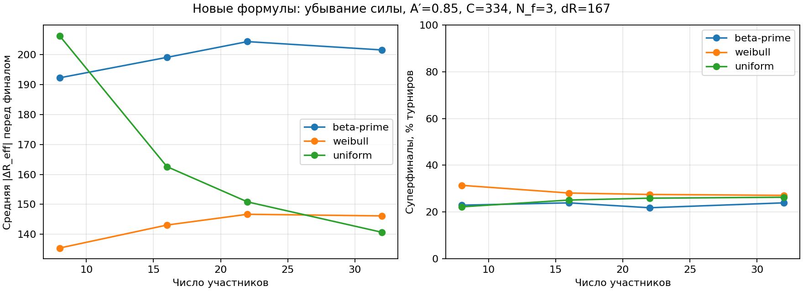

# Финалы и суперфиналы по новым формулам

Проведено **12,000 турниров**: по 1000 повторов для N=8, 16, 22, 32 на каждом из трёх распределений. Ещё три отдельных примера содержат по 22 участника.
Seed=42; случайная жеребьёвка, сетка DE_OLD_fix, выбывание после двух поражений.

## Формулы и исходные параметры

Источник: предоставленный PDF «Система_проведения_соревнований_новая_формула.pdf», с. 3–5.
Знак степени согласован с пользователем: **положительный**, сила уменьшается.
В PDF напечатана отрицательная степень; при A′=0.85 она увеличивала бы силу.

```text
R_eff(S) = R₀ · 0.85^(S/(3·334))
S_a ← S_a + max(0,334−|R_eff,a−R_eff,b|)
S_b ← S_b + max(0,334−|R_eff,a−R_eff,b|)
P(a победит) = 1 / (1+10^((R_eff,b−R_eff,a)/167))
```

Нагрузка рассчитывается по эффективным рейтингам до боя и одинакова для обоих участников.
При |ΔR_eff|≥334 нагрузка равна нулю, в том числе при разнице больше 400.
После трёх равных боёв S=1002, R_eff=0.85·R₀. Параметр A=0.9 из PDF
в новой формуле не используется. При преимуществе 167 пунктов вероятность победы 90.909%.

| Распределение | Параметры |
|---|---|
| beta-prime | α=135.1, β=65.2, scale=530; усечение [600,1900) |
| weibull | shape=2.2, scale=220, location=852; без усечения |
| uniform | [600,1900) |

Три варианта трактуются как три поддерживаемых распределения. Их форма и масштаб различаются.
Рейтинги генерируются заново для каждого повтора. Коэффициенты усталости не подбирались.

## Три примера с 22 участниками

| Распределение | R_eff верхней ветки | R_eff нижней ветки | Модуль разности | Суперфинал | Чемпион |
|---|---:|---:|---:|---|---:|
| [beta-prime](new-formulas-report-n22-beta-prime.md) | 1626.442 | 1342.220 | 284.222 | нет | 4 |
| [weibull](new-formulas-report-n22-weibull.md) | 958.085 | 978.265 | 20.180 | нет | 13 |
| [uniform](new-formulas-report-n22-uniform.md) | 1851.665 | 1372.284 | 479.381 | нет | 6 |

В каждом примере приведены все участники, жеребьёвка, места и полный журнал боёв.

## Статистика серий

Разность измеряется **перед первым финалом**, до добавления нагрузки за него.
Знак Δ означает верхняя ветка минус нижняя; модуль характеризует близость силы финалистов.
Верхняя ветка определяется по нулю предыдущих поражений, независимо от порядка ячеек.

| Распределение | N | Средняя Δ | Средняя ∣Δ∣ | Медиана ∣Δ∣ | P95 ∣Δ∣ | Макс. ∣Δ∣ | Суперфиналов | Доля |
|---|---:|---:|---:|---:|---:|---:|---:|---:|
| beta-prime | 8 | 162.504 | 192.186 | 164.262 | 465.803 | 785.105 | 229/1000 | 22.9% |
| beta-prime | 16 | 162.600 | 199.014 | 166.540 | 477.787 | 691.639 | 239/1000 | 23.9% |
| beta-prime | 22 | 168.929 | 204.268 | 176.335 | 480.284 | 687.743 | 218/1000 | 21.8% |
| beta-prime | 32 | 160.924 | 201.490 | 173.206 | 467.367 | 782.208 | 239/1000 | 23.9% |
| weibull | 8 | 105.653 | 135.442 | 114.451 | 326.950 | 497.966 | 314/1000 | 31.4% |
| weibull | 16 | 104.253 | 143.111 | 125.439 | 334.856 | 626.994 | 281/1000 | 28.1% |
| weibull | 22 | 110.730 | 146.703 | 124.141 | 354.903 | 686.996 | 275/1000 | 27.5% |
| weibull | 32 | 109.580 | 146.159 | 122.135 | 363.509 | 571.211 | 271/1000 | 27.1% |
| uniform | 8 | 182.383 | 206.222 | 175.231 | 502.136 | 920.925 | 222/1000 | 22.2% |
| uniform | 16 | 130.809 | 162.578 | 138.138 | 400.289 | 724.277 | 251/1000 | 25.1% |
| uniform | 22 | 119.983 | 150.831 | 136.572 | 347.364 | 619.799 | 259/1000 | 25.9% |
| uniform | 32 | 108.012 | 140.712 | 126.005 | 323.708 | 533.523 | 263/1000 | 26.3% |



## Рейтинги перед суперфиналом

Здесь учтены только состоявшиеся суперфиналы. Для их доли в предыдущей таблице
знаменатель — все турниры соответствующей категории (1000).

| Распределение | N | Суперфиналов | Средняя Δ | Средняя ∣Δ∣ | Медиана ∣Δ∣ | P95 ∣Δ∣ |
|---|---:|---:|---:|---:|---:|---:|
| beta-prime | 8 | 229 | -5.752 | 95.146 | 75.779 | 284.230 |
| beta-prime | 16 | 239 | -28.112 | 91.510 | 68.241 | 266.934 |
| beta-prime | 22 | 218 | -20.302 | 110.289 | 86.204 | 283.730 |
| beta-prime | 32 | 239 | -29.096 | 106.264 | 85.456 | 295.880 |
| weibull | 8 | 314 | 4.920 | 81.335 | 67.525 | 196.213 |
| weibull | 16 | 281 | -17.952 | 96.268 | 77.675 | 250.667 |
| weibull | 22 | 275 | -16.305 | 87.655 | 73.070 | 246.206 |
| weibull | 32 | 271 | -21.273 | 87.578 | 63.292 | 235.668 |
| uniform | 8 | 222 | -0.823 | 91.547 | 77.256 | 233.358 |
| uniform | 16 | 251 | -11.192 | 88.613 | 69.563 | 208.832 |
| uniform | 22 | 259 | -7.366 | 89.351 | 71.212 | 216.930 |
| uniform | 32 | 263 | -13.711 | 89.575 | 67.416 | 239.511 |

## Проверка и воспроизведение

Каждая категория прошла независимое воспроизведение таблиц переходов, усталости,
эффективных рейтингов, вероятностей, обновления рейтинга и расстановок мест.
Финальные показатели рассчитаны по проверенным CSV и JSONL. В каждой категории
добавлены finals.csv и finals-summary.json; исходные результаты сохранены в каталоге ниже.
Примеры — отдельные запуски с repeat=0; при наличии серии N=22 совпадают с её первым повтором.

Сводные числа и манифесты: [JSON](data/new-formulas-report.json).
Каталог сырых артефактов: `results/new-formulas`.
SHA256 исходного кода пакетов: `0206317f6b9b3046044b66f2ef7f7e15e2245464fd62ae79696de168437f3e7e`.

```bash
.venv/bin/python scripts/run_formula_experiment.py --sizes 8 16 22 32 --repeats 1000 --output results/new-formulas --report docs/new-formulas-report.md
.venv/bin/python -m unittest discover
.venv/bin/python -m ruff check .
```

Результаты описывают заданную модель и случайную жеребьёвку; посев SDE не реализован.
При 1000 повторах максимальная стандартная ошибка доли составляет около 1.58 процентного пункта.
