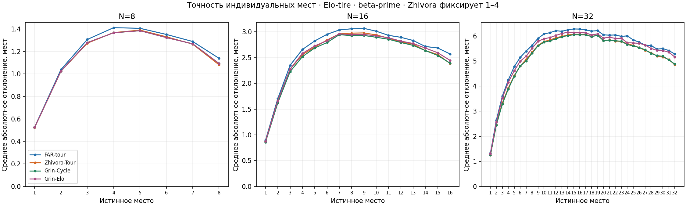
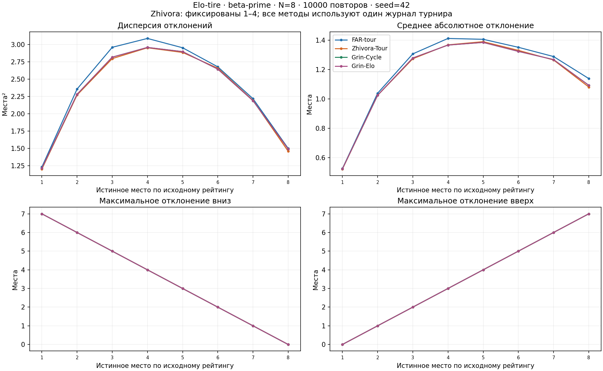
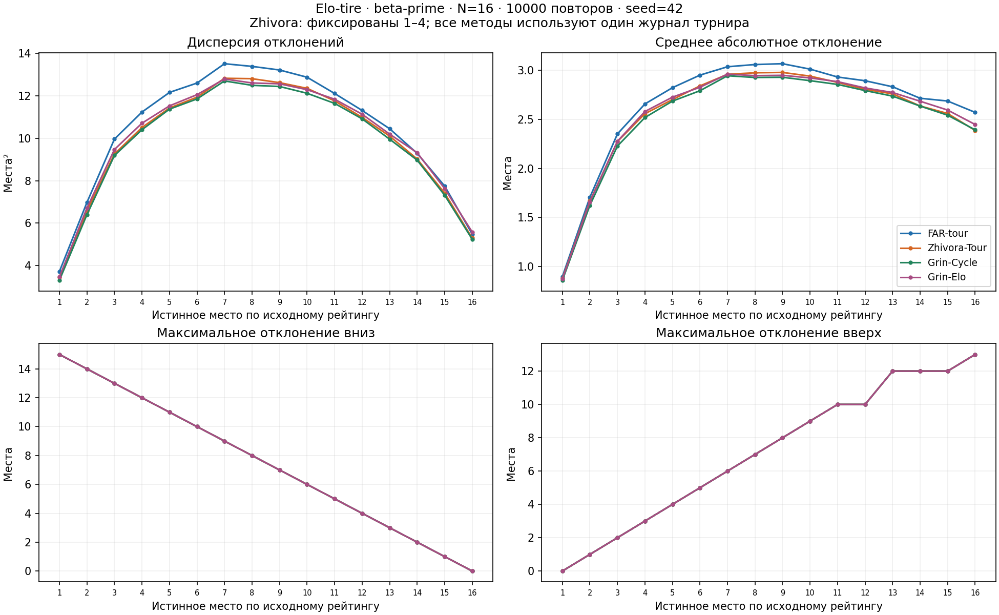
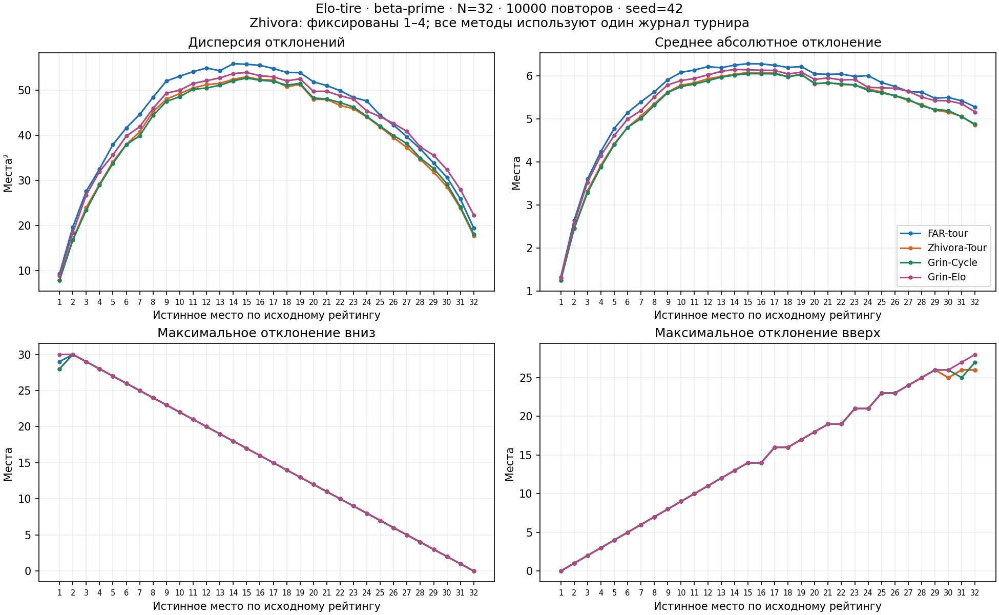

# Сравнение FAR-tour, Zhivora-Tour, Grin-Cycle и Grin-Elo

**30000 турниров**, N=8, 16, 32; по **10000 повторов**; seed=42.
На каждом турнире рассчитаны четыре метода: всего 120000 оценок расстановки.

Beta-prime: α=135.1, β=65.2, scale=530; [600,1900).
Elo-tire: A=0.85, A′=0.9, C=400, N_f=3; dR=200; K=160.
Сетка DE_OLD_fix, случайная жеребьёвка. Все методы используют **одни и те же бои**.
Zhivora-Tour: **фиксированы места 1–4**. [Описание и сверка с Pascal](placement-methods.md).
Веса Grin-Cycle равны, 0.33/0.33/0.33 с нормированием.

## Точность и полнота

MAE — среднее абсолютное расстояние между назначенным и истинным местом.
Каждому спортсмену назначается индивидуальное место; эталон — исходные рейтинги по убыванию, равенства по ID.
Меньше MAE — лучше; больше Spearman — лучше. Неполные расстановки исключаются из метрик целиком.

| N | Метод | Полных | Пропущено | MAE | 95% интервал MAE | Spearman | P95 MAE | Максимальная MAE |
|---:|---|---:|---:|---:|---|---:|---:|---:|
| 8 | FAR-tour | 10000 | 0 | 1.184075 | [1.174633, 1.193517] | 0.734219 | 2.000000 | 3.750000 |
| 8 | Zhivora-Tour | 10000 | 0 | 1.157475 | [1.147994, 1.166956] | 0.744502 | 2.000000 | 3.500000 |
| 8 | Grin-Cycle | 10000 | 0 | 1.158525 | [1.148950, 1.168100] | 0.743117 | 2.000000 | 3.500000 |
| 8 | Grin-Elo | 10000 | 0 | 1.158525 | [1.148950, 1.168100] | 0.743117 | 2.000000 | 3.500000 |
| 16 | FAR-tour | 10000 | 0 | 2.636900 | [2.624774, 2.649026] | 0.706951 | 3.750000 | 5.750000 |
| 16 | Zhivora-Tour | 10000 | 0 | 2.549787 | [2.537718, 2.561857] | 0.724326 | 3.625000 | 5.250000 |
| 16 | Grin-Cycle | 10000 | 0 | 2.522350 | [2.509950, 2.534750] | 0.728198 | 3.625000 | 5.375000 |
| 16 | Grin-Elo | 10000 | 0 | 2.557775 | [2.544851, 2.570699] | 0.720568 | 3.750000 | 5.375000 |
| 32 | FAR-tour | 10000 | 0 | 5.479394 | [5.462884, 5.495904] | 0.693680 | 6.937500 | 9.125000 |
| 32 | Zhivora-Tour | 10000 | 0 | 5.222112 | [5.205667, 5.238558] | 0.719645 | 6.687500 | 9.312500 |
| 32 | Grin-Cycle | 10000 | 0 | 5.209450 | [5.192403, 5.226497] | 0.719689 | 6.750000 | 9.375000 |
| 32 | Grin-Elo | 10000 | 0 | 5.362019 | [5.342985, 5.381052] | 0.702952 | 7.062500 | 10.312500 |



## Парные сравнения

Разность рассчитывается внутри одного турнира, затем усредняется по общим полным повторам.
Отрицательное значение означает меньшую MAE у левого метода. Интервалы рассчитаны для каждого сравнения отдельно.

| N | Сравнение: левая − правая MAE | Общих повторов | Средняя разность | 95% интервал разности |
|---:|---|---:|---:|---|
| 8 | FAR-tour − Zhivora-Tour | 10000 | 0.026600 | [0.022385, 0.030815] |
| 8 | FAR-tour − Grin-Cycle | 10000 | 0.025550 | [0.020501, 0.030599] |
| 8 | FAR-tour − Grin-Elo | 10000 | 0.025550 | [0.020501, 0.030599] |
| 8 | Zhivora-Tour − Grin-Cycle | 10000 | -0.001050 | [-0.003899, 0.001799] |
| 8 | Zhivora-Tour − Grin-Elo | 10000 | -0.001050 | [-0.003899, 0.001799] |
| 8 | Grin-Cycle − Grin-Elo | 10000 | 0.000000 | [0.000000, 0.000000] |
| 16 | FAR-tour − Zhivora-Tour | 10000 | 0.087112 | [0.081433, 0.092792] |
| 16 | FAR-tour − Grin-Cycle | 10000 | 0.114550 | [0.106279, 0.122821] |
| 16 | FAR-tour − Grin-Elo | 10000 | 0.079125 | [0.069815, 0.088435] |
| 16 | Zhivora-Tour − Grin-Cycle | 10000 | 0.027438 | [0.021184, 0.033691] |
| 16 | Zhivora-Tour − Grin-Elo | 10000 | -0.007987 | [-0.015523, -0.000452] |
| 16 | Grin-Cycle − Grin-Elo | 10000 | -0.035425 | [-0.039664, -0.031186] |
| 32 | FAR-tour − Zhivora-Tour | 10000 | 0.257281 | [0.248715, 0.265848] |
| 32 | FAR-tour − Grin-Cycle | 10000 | 0.269944 | [0.257647, 0.282241] |
| 32 | FAR-tour − Grin-Elo | 10000 | 0.117375 | [0.101406, 0.133344] |
| 32 | Zhivora-Tour − Grin-Cycle | 10000 | 0.012663 | [0.003986, 0.021339] |
| 32 | Zhivora-Tour − Grin-Elo | 10000 | -0.139906 | [-0.153047, -0.126766] |
| 32 | Grin-Cycle − Grin-Elo | 10000 | -0.152569 | [-0.163024, -0.142114] |

## Призёры и дополнительный этап

Чемпион и места 2–3 определяются решающими боями и совпадают у всех методов.
Победа сильнейшего поэтому является свойством проведённых боёв, а не способом сравнения этих четырёх методов.
При этом ошибки истинных сильнейших участников могут различаться, если они не попали в фактическую тройку.

| N | Сильнейший победил | Граф без цикла | Дополнительный этап | Доля запусков | Успешно разрешено | Резерв Grin-Elo |
|---:|---:|---:|---:|---:|---:|---:|
| 8 | 72.45% | 10000 | 0 | 0.00% | 0 | 0 |
| 16 | 66.14% | 9272 | 728 | 7.28% | 728 | 728 |
| 32 | 63.10% | 8263 | 1737 | 17.37% | 1737 | 1737 |

## Графики отклонений

Для каждого истинного места: дисперсия δ (ddof=0), среднее |δ|, максимум вниз и максимум вверх.
Все редкие результаты включены; увеличение числа повторов уменьшает шум среднего и лучше показывает хвост.

### N=8



### N=16



### N=32



## Выводы по этой серии

- N=8: минимальная MAE у **Zhivora-Tour**, 1.157475; снижение относительно FAR-tour — 2.25%.
- N=16: минимальная MAE у **Grin-Cycle**, 2.522350; снижение относительно FAR-tour — 4.34%.
- N=32: минимальная MAE у **Grin-Cycle**, 5.209450; снижение относительно FAR-tour — 4.93%.
- N=8: Zhivora − Grin-Cycle = -0.001050, 95% интервал [-0.003899, 0.001799]; интервал содержит ноль; устойчивое преимущество одного из этих двух методов не установлено.
- N=16: Zhivora − Grin-Cycle = 0.027438, 95% интервал [0.021184, 0.033691]; интервал положителен; Grin-Cycle имеет меньшую среднюю ошибку в данной модели.
- N=32: Zhivora − Grin-Cycle = 0.012663, 95% интервал [0.003986, 0.021339]; интервал положителен; Grin-Cycle имеет меньшую среднюю ошибку в данной модели.

При близких средних учитывайте парные интервалы выше. Полная разрешимость произвольного входа
и преимущество на других распределениях этой серией не доказаны.
Интервалы mean ± 1.96·std(ddof=1)/sqrt(T) характеризуют неопределённость моделирования при заданных коэффициентах.
Неопределённость подбора рейтингов и физиологическая калибровка усталости сюда не включены.

## Проверка и воспроизведение

Каждая категория прошла независимую проверку усталости, вероятностей, счётчиков,
хронологии FAR-tour, групп Живоры, диагностики циклов, индивидуальных метрик,
парных разностей и доверительных интервалов. Новые артефакты — schema 6; чтение 4/5 сохранено.
SHA256 пакетов: `4895c4ce2c60ad112676a02abc078d5e42c416e4012cecd8a2cc6341608d27fe`.
CSV/JSONL, метрики каждого турнира и индивидуальные графики всех методов: `results/placement-comparison`.

```bash
.venv/bin/python scripts/run_placement_comparison.py --repeats 10000 --seed 42 --zhivora-fixed-top 4 --output results/placement-comparison --report docs/placement-comparison-report.md
.venv/bin/python -m simulation.verify results/placement-comparison/n8
.venv/bin/python -m simulation.verify results/placement-comparison/n16
.venv/bin/python -m simulation.verify results/placement-comparison/n32
```
